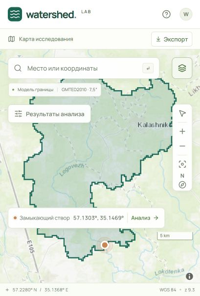
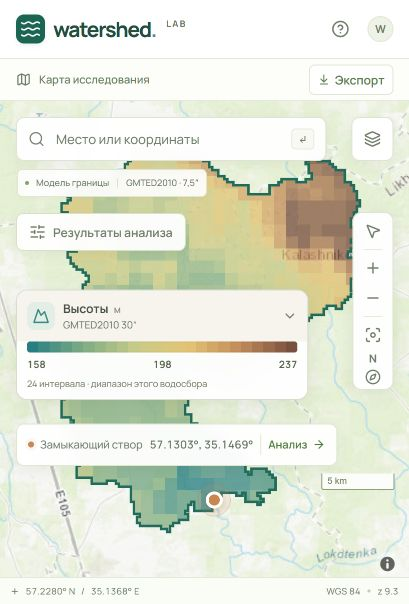
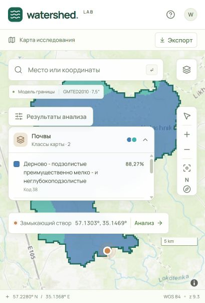
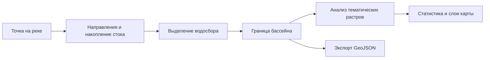

# Watersheds

**От точки на реке — к границе водосбора и характеристикам его территории.**

Watersheds — картографический веб-сервис для выделения и анализа водосборных бассейнов. Проект восстанавливает приложение, созданное в рамках магистерской диссертации: расчёт по цифровым моделям рельефа дополнен современным интерфейсом, тематическими слоями и оптимизированным хранением растров.

Выберите модель, укажите точку на реке и получите границу бассейна, характеристики рельефа, климатические показатели, состав почв и земного покрова.

| Выделенный водосбор | Высоты и цветовая шкала | Почвенный слой |
|:---:|:---:|:---:|
|  |  |  |

## Возможности

- **Выделение водосбора по точке.** Девять записей каталога ЦМР, выбор на карте или ввод координат, проверка доступности и полноты покрытия.
- **Анализ территории.** Площадь, минимальные, средние и максимальные высоты и уклоны, месячные температуры и осадки, доли классов почв и покрова.
- **Тематическая карта.** Высоты, уклоны, почвы и земной покров внутри бассейна; цветовые шкалы, легенды и подсказки при наведении.
- **Контуры покрытия ЦМР.** Обзорная граница помогает выбрать точку в области доступных данных, в том числе для региональных MERIT и ALOS.
- **История и экспорт.** Последние восемь расчётов в текущем сеансе страницы и скачивание границы в GeoJSON.
- **COG с ZSTD.** Чтение нужных окон растра без загрузки всей поверхности в память, с сохранением исходных значений и масок.

### Высоты и уклоны

Слои включаются соответствующими вкладками анализа. Подсказка показывает значение исходной ячейки: метры для высоты, градусы для уклона.

### Почвы и земной покров

Категориальные слои обрезаются по границе бассейна. Цвета на карте согласованы с легендой, а сводка показывает состав территории по классам.

## Быстрый старт

Это локальное приложение с собственным backend. **Большие растры не входят в репозиторий:** для расчёта нужны подготовленные гидрологические и тематические данные. Без локальной пары направлений и накопления стока каталог не предложит доступную модель. Имена файлов, схема папок и подготовка COG — в [руководстве по данным](docs/data.md).

Проверенное окружение: **Windows, Python 3.13, Node.js 22.12 или новее**, npm. Для расчёта также нужен исполняемый файл WhiteboxTools: пакет `whitebox` может загрузить его при первом запуске, поэтому на этом этапе требуется доступ к сети.

### 1. Скачайте проект и установите зависимости

Команды выполняются в PowerShell:

```powershell
git clone https://github.com/dmitrywalther/watersheds.git
Set-Location watersheds

python -m venv venv
.\venv\Scripts\python.exe -m pip install -r requirements.txt

Push-Location frontend
npm ci
Pop-Location
```

### 2. Подключите данные

Разместите подготовленные растры по схеме из [docs/data.md](docs/data.md). Пути и перечень моделей заданы в [config.py](config.py). Каталог направлений и накоплений можно дополнительно задать переменной окружения:

```powershell
$env:WATERSHED_DEM_DIR = 'D:\Hydrology\Data'
```

Эта переменная относится к парам `FlowDir`/`FlowAcc`. Тематические растры настраиваются отдельно в `config.py`. Их COG должны иметь подходящие манифесты проверки; [перенос файлов между установками](docs/data.md#перенос-данных-на-другую-машину) требует учёта сохранённых путей.

### 3. Запустите API и интерфейс

В первом терминале, из корня проекта:

```powershell
.\start-backend.ps1
```

Во втором терминале, из корня проекта:

```powershell
Set-Location frontend
npm run dev
```

API доступен по адресу `http://127.0.0.1:5000`. Откройте адрес, напечатанный Vite — обычно `http://localhost:5173`. Запросы интерфейса `/api/*` проксируются на Flask. Для картографических подложек Esri и OpenFreeMap требуется интернет.

## Как пользоваться

1. Выберите доступную ЦМР. Кнопка «Показать покрытие» приблизит карту к области её данных.
2. Укажите точку на реке щелчком или введите широту и долготу. Нажмите «Построить водосбор».
3. Изучите сводку. Переключайте вкладки «Высоты», «Уклоны», «Покров» и «Почвы», чтобы показать соответствующий слой. «Обзор» и «Климат» скрывают тематическую заливку.
4. Наведите указатель на слой внутри бассейна: подсказка покажет значение или название класса. На сенсорном устройстве доступно нажатие.
5. Скачайте границу кнопкой «Экспорт». История позволяет вернуться к недавним расчётам; после обновления страницы она очищается.

Меню «Слои карты» управляет подложкой, контуром бассейна и покрытием ЦМР. При выборе новой модели или точки предыдущий результат сбрасывается.

## Как это работает



Backend использует **Flask, Rasterio, GeoPandas, Rasterstats и WhiteboxTools**. Интерфейс построен на **React, Vite, MapLibre GL и Recharts**. Рабочие растры читаются локально; исходное разрешение используется для анализа и значений подсказок.

## Границы применения

- Покрытие модели может содержать участки NoData. Точка внутри обзорного контура ещё не гарантирует, что весь водосбор поместится в данных.
- Подробная ЦМР уточняет границу бассейна, но не повышает разрешение общих слоёв высот, уклонов, почв, покрова или климата.
- Площадь вычисляется в проекции расчёта. Для подготовленных сеток `EPSG:3395` искажения Меркатора влияют на результат; размер ячейки в проекции не равен её размеру на местности.
- Крупные тематические слои обобщаются для отображения. Это отмечается в легенде; точная статистика не пересчитывается по обзорному слою.
- Watersheds завершает задачу выделения и анализа бассейнов. **Моделирование наводнений, прогноз и оценка ущерба выделены в отдельное направление разработки.** Сохранённые экспериментальные модули HAND и оценки зданий не подключены как рабочая возможность текущего интерфейса.

## Документация и разработка

- [Данные, каталог ЦМР, подготовка COG и ограничения анализа](docs/data.md).
- [Архитектура, API, тесты и устранение проблем запуска](docs/development.md).

Backend-тесты:

```powershell
.\venv\Scripts\python.exe -m unittest discover -s tests -v
```

Проверки и сборка интерфейса:

```powershell
Push-Location frontend
node --test src/lib/*.test.js
npm run lint
npm run build
Pop-Location
```

Репозиторий содержит код, тесты, документацию и словари классов. Подготовленные растры, локальные кэши и отчёты обработки данных хранятся отдельно.
